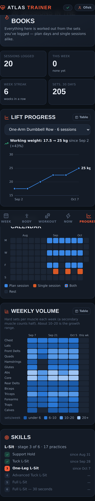

# Atlas Trainer

A personal-trainer web app. Pick the muscles you want to train, and it splits them across your week, builds every session from the gear you actually own, adjusts weights and reps from how each set felt, and shows your progress over time. React + Supabase, installable on a phone.



## What it does

- **Weekly split.** The muscles you pick are spread across your training days (Push / Pull / Legs, Upper / Lower, quad and hinge days…). Every possible arrangement is scored, then the top candidates are built for real to check which muscles actually get trained. The week tells you honestly when your time doesn't fit everything.
- **Progression.** Double progression (reps, then load), a deload after two hard sessions, and bodyweight ladders. Skills such as the L-sit move up a stage after two clean sessions in a row.
- **Single sessions.** A one-off workout (core, arms, full body…) as a circuit or straight sets. It counts toward your history and progression but never toward the weekly plan.
- **Progress.** Charts per lift, a training calendar, a weekly-volume heatmap per muscle, and skill-ladder dates.
- **Saving.** Every set is written to Postgres. If the connection drops, writes queue on the device and upload later without ever creating duplicates.

## Architecture

```
src/engine/   pure training logic: no I/O, all unit-tested
  generator.js   session solver, progression, skills
  week.js        weekly split search + per-muscle coverage check
  quick.js       single sessions
  history.js     the training log → volume, sessions, history
  progress.js    everything the Progress tab shows
src/data/     the only code that talks to Supabase
  client.js      project URL + anon key (build env or a one-time setup screen)
  mapping.js     database rows ↔ app model (pure)
  outbox.js      persisted write queue: coalescing, batching, retry and backoff, dead-letter
  repo.js        load (with offline cache), saveProfile, syncLog (only what changed), resetAll
src/ui/       React screens
supabase/migrations/   schema + row-level security
tests/        engine suites, schema/RLS on real Postgres, data layer, end-to-end
```

**Data model.** `profiles` (one row per user: settings as jsonb), `workout_sessions` (one per workout), `exercise_logs` (one per exercise in a session, primary key `(session_id, slot)`). The log is the source of truth; volume, progression and charts are derived from it, never stored.

**Why ids come from the device.** Sessions get a `crypto.randomUUID()` on the phone and every write is an upsert on a key the phone already knows. A write that times out can be retried any number of times, and re-rating an exercise overwrites its row, so neither can create a duplicate.

**Security.** Row-level security on every table: you read and write only rows whose `user_id` is yours. A log row must also belong to one of *your* sessions, because foreign keys are checked without RLS. The anon key is public by design, and the setup screen refuses the `service_role` key.

## Set it up (about 10 minutes)

### 1. Supabase

1. Create a free project at [supabase.com](https://supabase.com).
2. Open the **SQL Editor**, paste [`supabase/migrations/20261015000000_init.sql`](supabase/migrations/20261015000000_init.sql) and press **Run**.
3. Under **Authentication → Sign In / Providers → Email**, either keep **Confirm email** on (you'll get a link when you sign up) or turn it off, since you're the only user.
4. Under **Authentication → URL Configuration**, set **Site URL** to your Netlify address once you have it (step 2). Confirmation links go there.
5. Under **Project Settings → API**, copy the **Project URL** and the **anon public** key.

### 2. Netlify

There are two ways to deploy:

- **From GitHub (recommended).** Push this repo to GitHub. In Netlify choose **Add new site → Import an existing project**, then pick the repo; the build settings come from `netlify.toml`. Under **Site configuration → Environment variables**, add `VITE_SUPABASE_URL` and `VITE_SUPABASE_ANON_KEY`, then deploy. Every push redeploys.
- **Drag and drop.** Run `npm run build` and drag the `dist` folder onto [app.netlify.com/drop](https://app.netlify.com/drop). The first time you open the site it asks for the Project URL and anon key and remembers them on that device.

### 3. On your phone

Open the Netlify URL, sign up, then use **Share → Add to Home Screen**. It opens full-screen like an app, and the app shell loads even without signal.

## Develop

```bash
npm install
cp .env.example .env.local   # optional; the app can ask for these instead
npm run dev
```

## Test

```bash
npm test     # builds, then runs every suite; set CHROMIUM_PATH if Playwright needs a specific browser
```

| Suite | What it proves |
|---|---|
| `verify` | No exercise, warm-up or cue mentions gear the user doesn't own (12 kits) |
| `audit2` | Programming quality across 792 configs: volume ceilings, session length, rest, rep ranges |
| `rebuildtest` | Rebuild / swap / hide give real alternatives |
| `quicktest` | 11,520 single sessions: right area, gear, length, circuit rules, variety |
| `historytest` | Single sessions feed progression but never change the weekly routine |
| `weektest` | 720 weekly plans: every pick placed, full coverage when there's time, frequency, recovery spacing |
| `progresstest` | Progress maths and skill pacing, against hand-built logs with known answers |
| `schematest` | The real migration on real Postgres (PGlite): owner-only RLS, cross-user writes refused, idempotent upserts, cascades |
| `repotest` | The data layer over HTTP with supabase-js: round-trips, offline outbox surviving a "closed tab", a rejected row not blocking the queue, more than 1,000 rows |
| `e2e` | The production build in Chromium: connect → sign up → onboard → train → offline → single session → weekly split → Progress → sign out / in → second user isolated → layout |
| `csptest` | The production Content-Security-Policy doesn't block anything the app needs |

The database-backed suites run against `tests/fake-supabase.mjs`: real Postgres with the real migration, behind a small GoTrue/PostgREST-compatible HTTP server. They exercise the same client library, the same requests and the same RLS as supabase.co.
